<div align="center">

# ✅ Team Task Manager

### Ekibinizin projelerini, görevlerini ve iş akışını tek yerden yönetin.
**API · Web · Mobil** — aynı backend, iki istemci, tek tasarım dili.


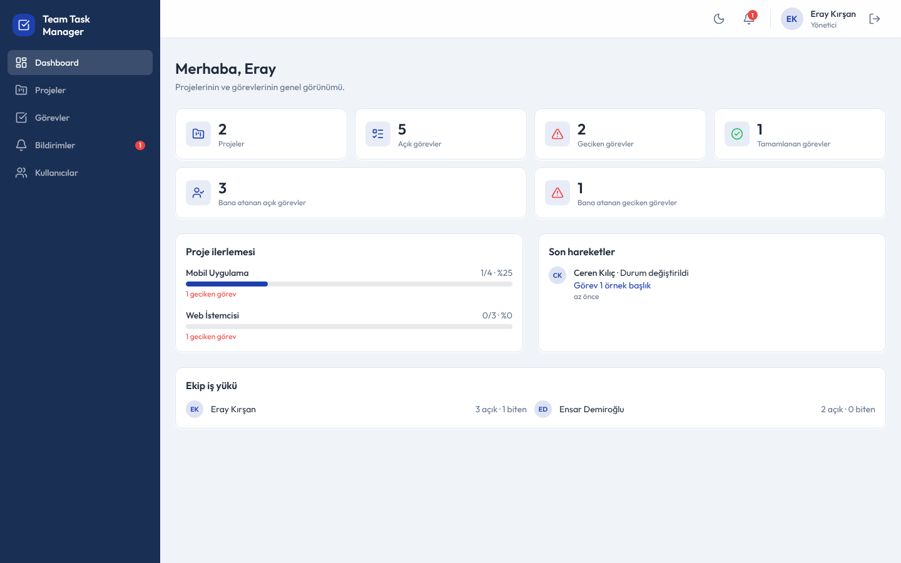

</div>

---

## 📑 İçindekiler
[Neden Team Task Manager?](#-neden-team-task-manager) · [Özellikler](#-özellikler) · [Mimari](#-mimari) · [Web](#-web-arayüzü) · [Mobil](#-mobil-uygulama) · [Roller](#-roller-ve-yetkiler) · [Kurulum](#-kurulum) · [Web kurulumu](#-web-kurulumu) · [Mobil kurulumu](#-mobil-kurulumu) · [Testler](#-testler-ve-ci) · [Ekip](#-ekip)

## 🎯 Neden Team Task Manager?
Dağınık tablolar, kaybolan mesajlar ve "bu görev kimdeydi?" soruları yerine:
- 📌 Her görevin **sahibi, önceliği, durumu ve bitiş tarihi** net.
- 👥 Herkes **rolüne uygun** olanı görür ve yapar.
- 🔔 Atamalar ve durum değişiklikleri **bildirim** olarak gelir.
- 📱💻 Masaüstünde **web**, cepte **mobil** — aynı hesap, aynı veri.

## ✨ Özellikler

| | Özellik | Web | Mobil |
|---|---|:-:|:-:|
| 🔐 | JWT ile giriş, rol tabanlı yetkilendirme | ✅ | ✅ |
| 📊 | Dashboard: açık/geciken görevler, proje ilerlemesi, ekip iş yükü, son hareketler | ✅ | ✅ (görev ve bildirim özeti) |
| 📁 | Proje oluşturma, düzenleme, silme, **üye yönetimi** | ✅ | – |
| ✅ | Görev oluşturma, atama, öncelik ve bitiş tarihi | ✅ | – |
| 🔎 | Arama, filtre, sıralama, sayfalama | ✅ | – |
| 🗂️ | **Kanban panosu** (sürükle-bırak ile durum değiştirme) | ✅ | – |
| 🔄 | Görev durumu güncelleme | ✅ | – |
| 💬 | Görev yorumları | ✅ | – |
| 📎 | Dosya ekleme ve indirme (10 MB'a kadar) | ✅ | – |
| 🔔 | Bildirimler (atama, durum değişikliği, yorum, projeye ekleme) | ✅ | ✅ |
| 👤 | Kullanıcı yönetimi: rol ekleme, aktif/pasif, yeni kullanıcı | ✅ (Admin) | – |
| 🌗 | Açık ve koyu tema | ✅ | ✅ |
| 🧾 | Aktivite geçmişi | ✅ | – |

## 🏗️ Mimari

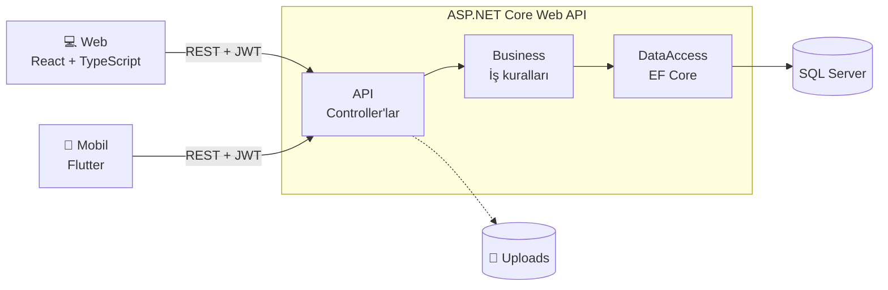

| Proje | Görev |
|---|---|
| `TeamTaskManager.API` | Controller'lar, middleware, `Program.cs`, yapılandırma |
| `TeamTaskManager.Business` | İş kuralları ve servisler |
| `TeamTaskManager.DataAccess` | `AppDbContext` ve migration'lar |
| `TeamTaskManager.Entities` | Veritabanı varlıkları ve enum'lar |
| `TeamTaskManager.DTO` | İstek ve yanıt modelleri |
| `TeamTaskManager.Core` | Ortak altyapı için ayrılmış proje (şimdilik boş) |
| `web/` | React web istemcisi |
| `mobile/` | Flutter mobil istemcisi |

## 💻 Web arayüzü
Mobil uygulamayla aynı renk paleti ve tasarım dili. Açık ve koyu tema, her ekranda.

<table>
<tr>
<td>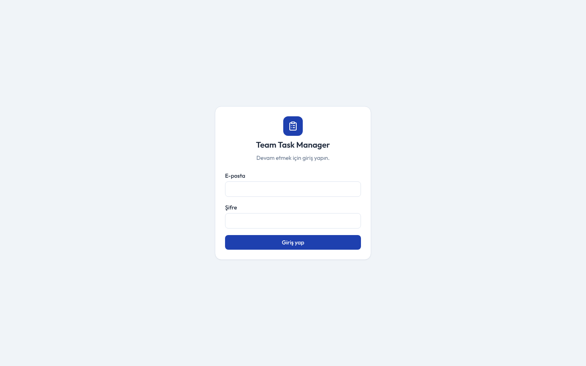<br><sub><b>Giriş</b></sub></td>
<td>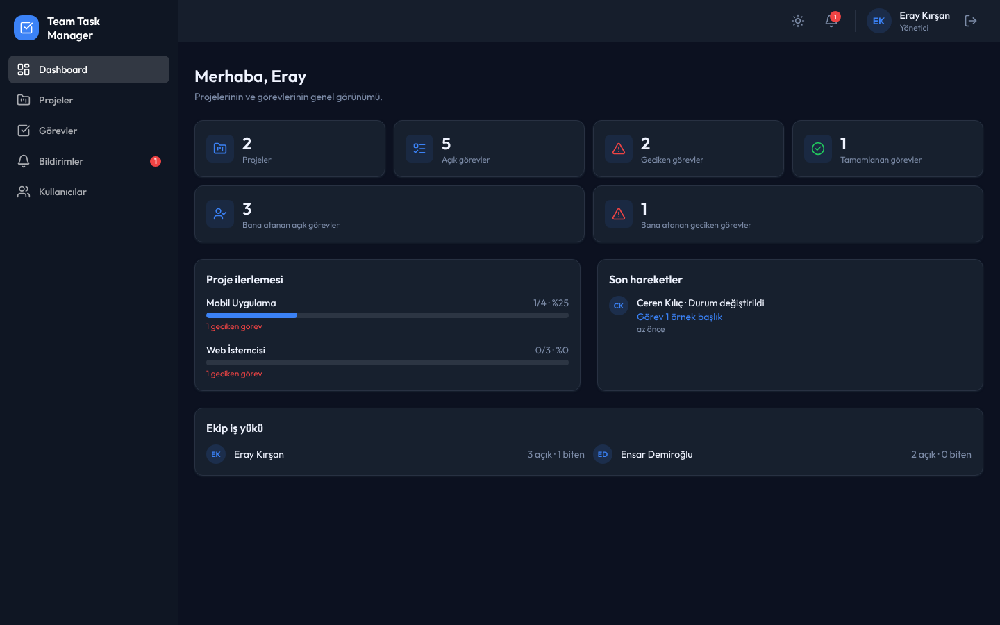<br><sub><b>Dashboard (koyu tema)</b></sub></td>
</tr>
<tr>
<td>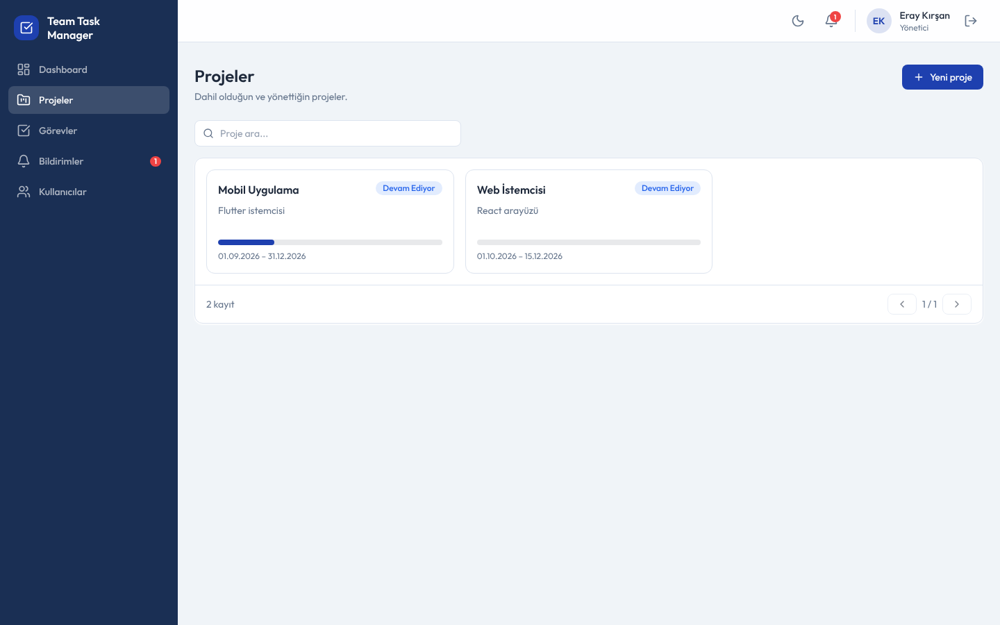<br><sub><b>Projeler</b></sub></td>
<td>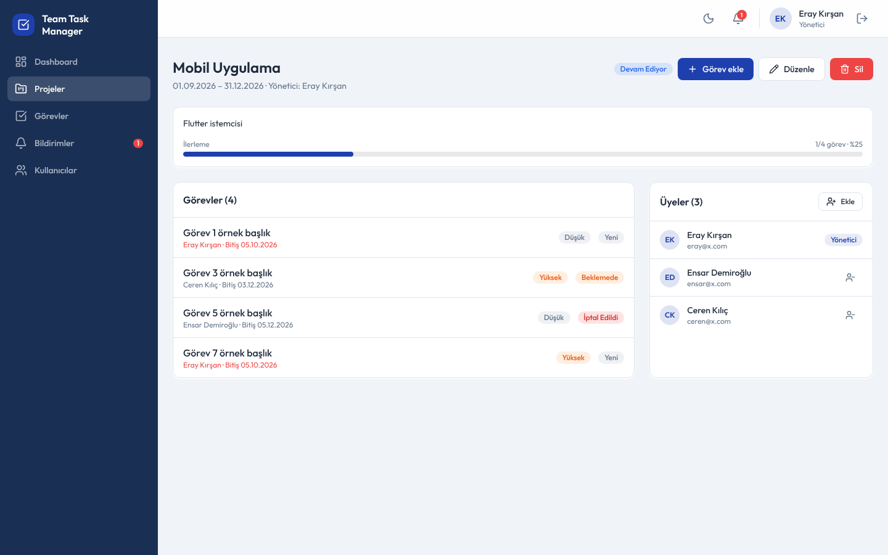<br><sub><b>Proje detayı ve üyeler</b></sub></td>
</tr>
<tr>
<td>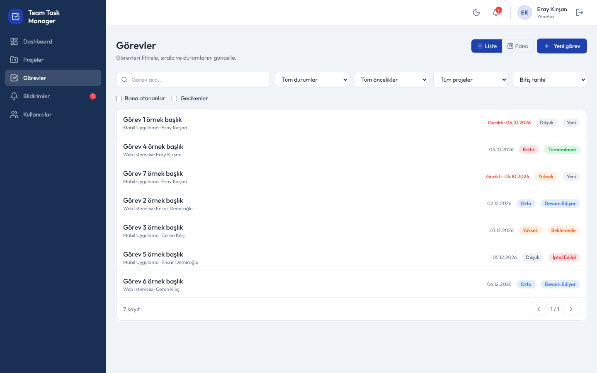<br><sub><b>Görevler: filtre, sıralama, sayfalama</b></sub></td>
<td>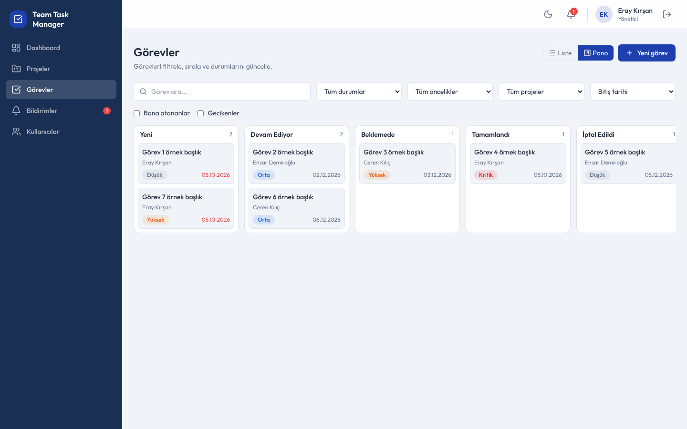<br><sub><b>Kanban panosu (sürükle-bırak)</b></sub></td>
</tr>
<tr>
<td>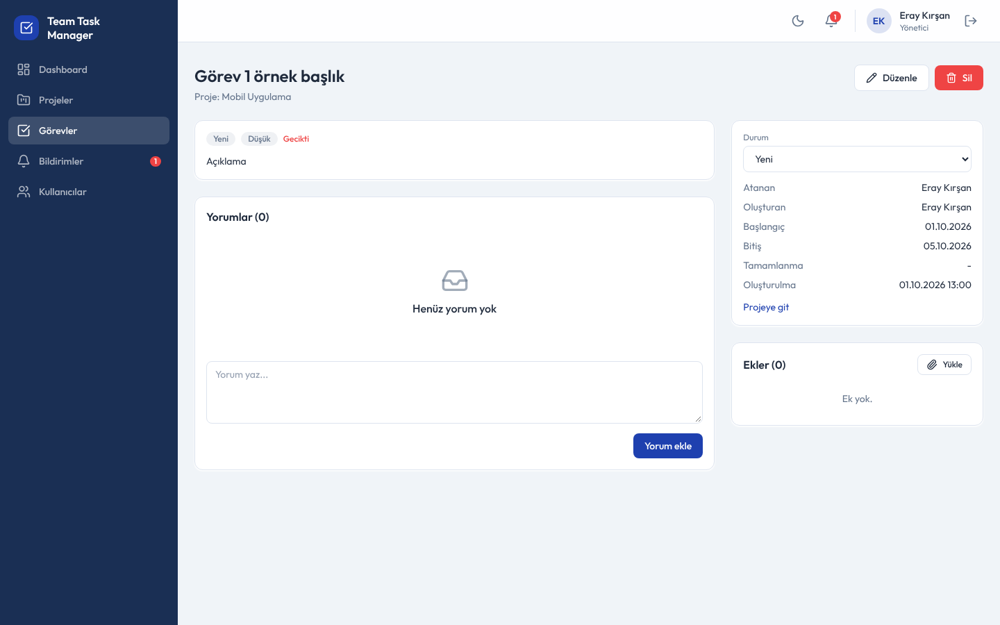<br><sub><b>Görev detayı: durum, yorum, dosya</b></sub></td>
<td>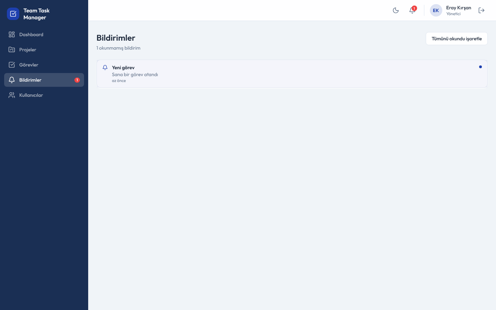<br><sub><b>Bildirimler</b></sub></td>
</tr>
<tr>
<td>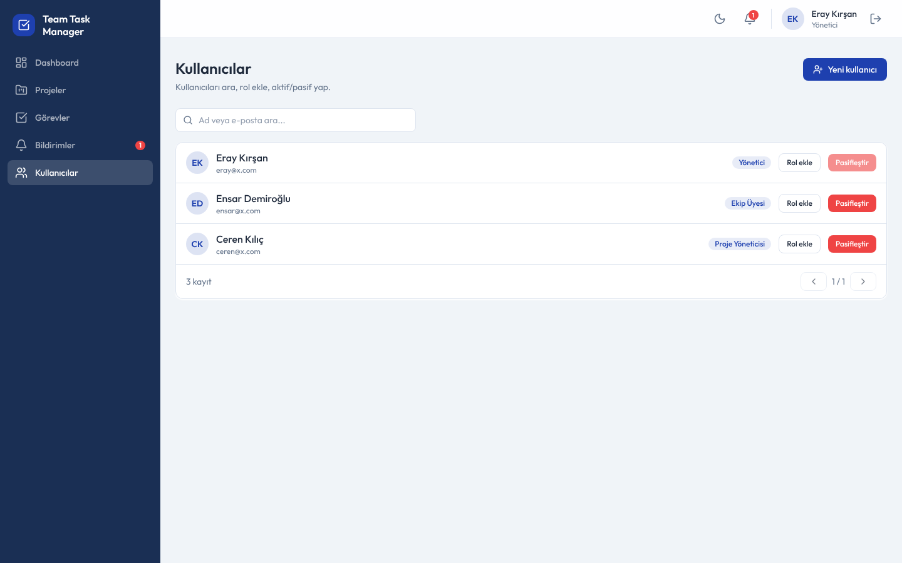<br><sub><b>Kullanıcılar (Admin)</b></sub></td>
<td>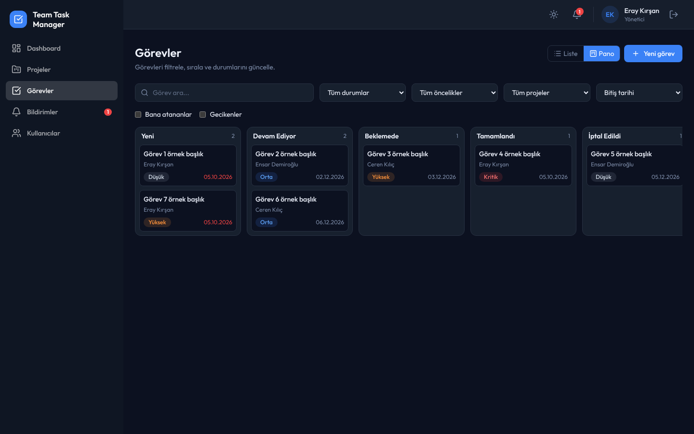<br><sub><b>Kanban (koyu tema)</b></sub></td>
</tr>
</table>

> Görüntülerdeki veriler örnek amaçlıdır.

## 📱 Mobil uygulama
Flutter ile geliştirilen mobil istemci; görevlerinize, bildirimlerinize ve yorumlara cepten ulaşmanızı sağlar.

> ℹ️ Görev detayı ekranı şimdilik statik arayüzdür; durum güncelleme ve yorum işlemleri web istemcisinden yapılır.

**☀️ Açık tema**

<table><tr><td align="center">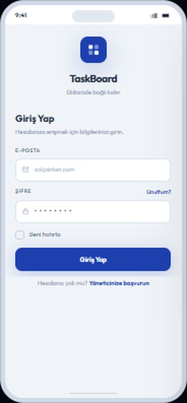<br><sub><b>Giriş</b></sub></td><td align="center">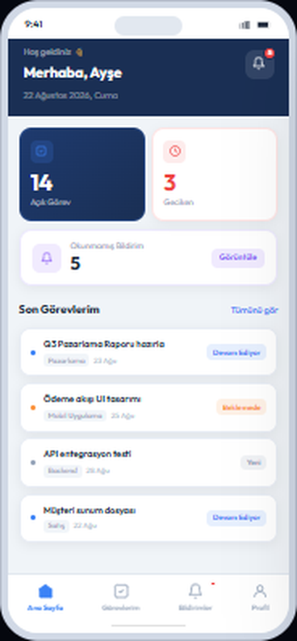<br><sub><b>Ana sayfa</b></sub></td><td align="center">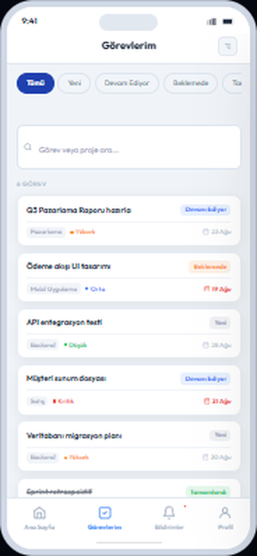<br><sub><b>Görevlerim</b></sub></td><td align="center">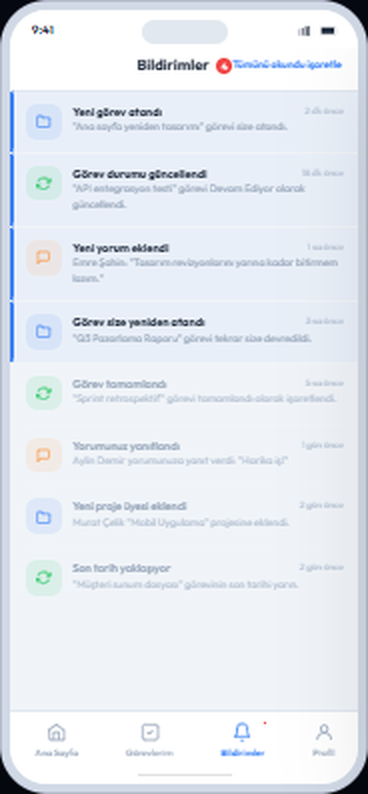<br><sub><b>Bildirimler</b></sub></td></tr></table>

<table><tr><td align="center">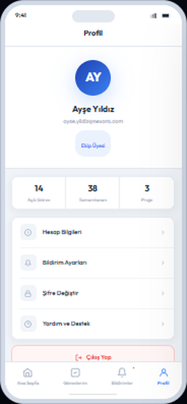<br><sub><b>Profil</b></sub></td><td align="center">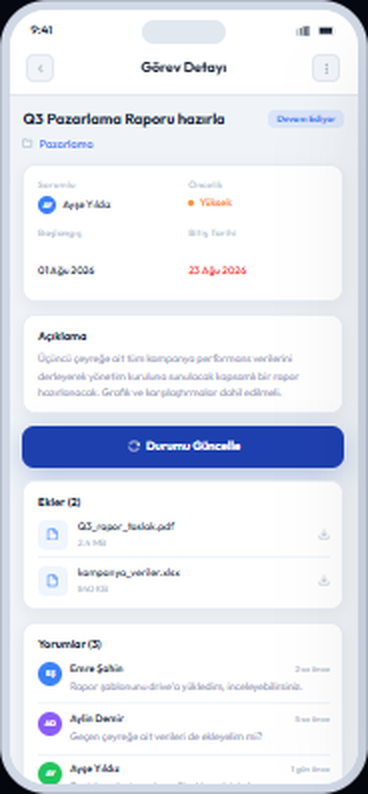<br><sub><b>Görev detayı</b></sub></td></tr></table>

**🌙 Koyu tema**

<table><tr><td align="center">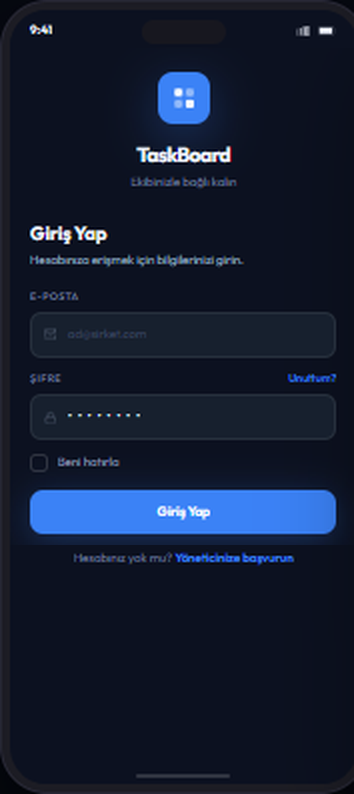<br><sub><b>Giriş</b></sub></td><td align="center">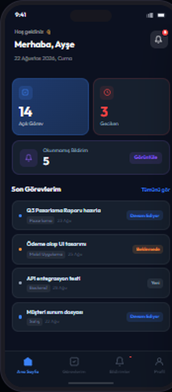<br><sub><b>Ana sayfa</b></sub></td><td align="center">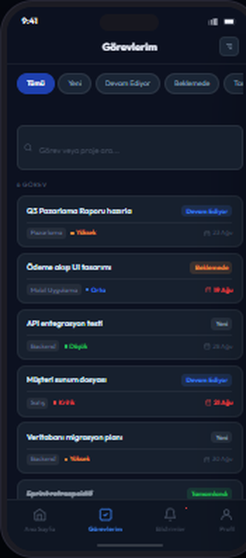<br><sub><b>Görevlerim</b></sub></td><td align="center">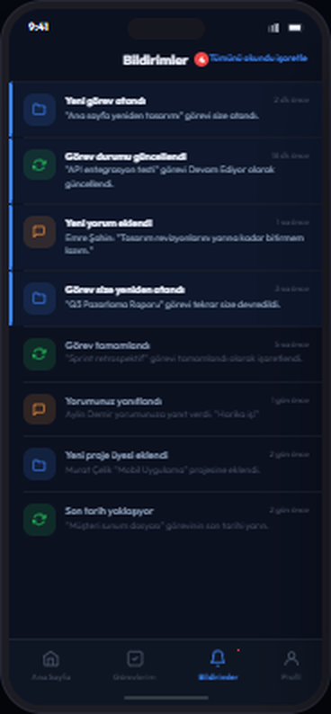<br><sub><b>Bildirimler</b></sub></td></tr></table>

<table><tr><td align="center">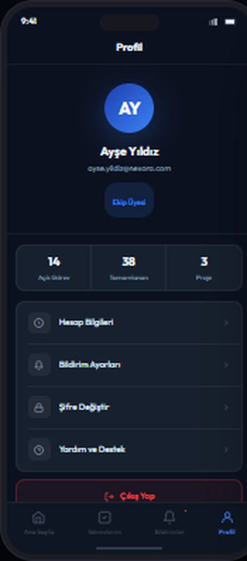<br><sub><b>Profil</b></sub></td><td align="center">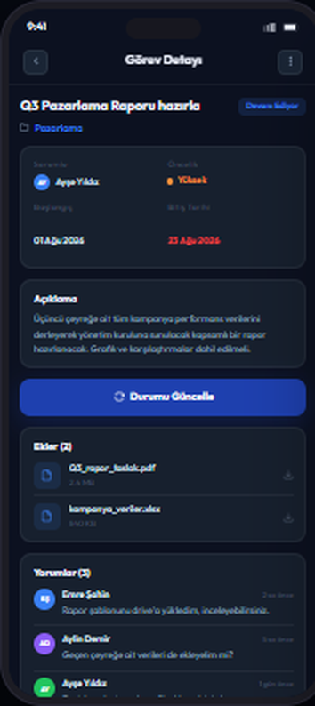<br><sub><b>Görev detayı</b></sub></td></tr></table>

## 👥 Roller ve yetkiler

| Rol | Yetki |
|---|---|
| 👑 Admin | Her şey; kullanıcı kaydı, rol atama, aktif/pasif yapma |
| 🧭 ProjectManager | Proje ve görev oluşturma, güncelleme, silme, üye yönetimi (kendi projelerinde) |
| 🙋 TeamMember | Kendi görevlerini görme, durum güncelleme, yorum ve dosya ekleme |

Kullanıcı kaydı yalnızca Admin tarafından yapılır. Yeni kullanıcı TeamMember rolüyle açılır; rolü `assign-role` ile genişletilir.

## 🧰 Teknolojiler

| Katman | Teknoloji |
|---|---|
| Backend | ASP.NET Core Web API (.NET 10), Entity Framework Core, ASP.NET Core Identity, SQL Server (LocalDB), JWT Bearer, Swagger |
| Web | React 18, TypeScript, Vite, Tailwind CSS, TanStack Query, React Hook Form + Zod, React Router, Vitest |
| Mobil | Flutter, Dio, Provider, go_router, flutter_secure_storage |
| DevOps | GitHub Actions (backend derleme/test + web typecheck/test/build) |

## 🚀 Kurulum

Gereksinimler: [.NET 10 SDK](https://dotnet.microsoft.com/download), SQL Server veya Visual Studio ile gelen LocalDB.

```bash
git clone https://github.com/krsneray/team-task-management.git
cd team-task-management
```

### 1️⃣ Gizli ayarlar

JWT anahtarı ve ilk yönetici parolası repoda tutulmaz; kendi makinenizde `user-secrets` ile verin:

```bash
dotnet user-secrets set "Jwt:Key" "en-az-32-karakterlik-rastgele-bir-deger" --project TeamTaskManager.API
dotnet user-secrets set "InitialAdmin:Password" "GucluBirParola123!" --project TeamTaskManager.API
```

`Jwt:Key` en az 32 karakter olmalıdır; aksi halde uygulama başlamaz. Parola en az 8 karakter olmalıdır. İlk yönetici hesabının e-postası `appsettings.json` içindeki `InitialAdmin:Email` değeridir.

### 2️⃣ Veritabanı

Bağlantı dizesi `appsettings.json` içindeki `ConnectionStrings:Default` alanındadır (varsayılan: LocalDB).

```bash
dotnet tool install --global dotnet-ef
dotnet ef database update --project TeamTaskManager.DataAccess --startup-project TeamTaskManager.API
```

### 3️⃣ API'yi çalıştırma

```bash
dotnet run --project TeamTaskManager.API
```

Swagger arayüzü: `https://localhost:7109/swagger` (geliştirme ortamında). Giriş yapmak için `POST /api/auth/login` ile token alın, Swagger'daki **Authorize** düğmesine `Bearer {token}` yazın.

## 🌐 Web kurulumu

Node.js 20 veya üstü gerekir.

```bash
cd web
cp .env.example .env     # API adresi: VITE_API_URL=http://localhost:5052
npm install
npm run dev              # http://localhost:5173
```

| Komut | Ne yapar |
|---|---|
| `npm run dev` | Geliştirme sunucusu |
| `npm test` | Birim ve bileşen testleri |
| `npm run typecheck` | TypeScript kontrolü |
| `npm run build` | Üretim derlemesi |

Geliştirme ortamında `http://localhost:5173` adresine CORS izni vardır (`appsettings.Development.json`). Ayrıntılar için [`web/README.md`](web/README.md).

## 📲 Mobil kurulumu

```bash
cd mobile
flutter pub get
flutter run
```

Emülatör için API adresini ve ayrıntıları [`mobile/README.md`](mobile/README.md) dosyasında bulabilirsiniz.

## 🔗 İstemciler için CORS

Tarayıcıdan çalışan bir web istemcisi bağlanacaksa adresini izinli listeye ekleyin (`appsettings.json` ya da user-secrets):

```json
"Cors": { "AllowedOrigins": [ "http://localhost:5173" ] }
```

Mobil uygulamalar için CORS gerekmez.

## 📎 Dosya yükleme

Görevlere eklenen dosyalar `TeamTaskManager.API/Uploads/` klasörüne kaydedilir (repoya girmez). En fazla 10 MB; pdf, png, jpg, jpeg, gif, txt, doc/docx, xls/xlsx, ppt/pptx ve zip uzantılarına izin verilir.

## 🧪 Testler ve CI
Her `push` ve pull request'te GitHub Actions şunları çalıştırır:
- **build**: `dotnet restore`, `build`, `test`
- **web**: `npm ci`, `typecheck`, `test`, `build`

## 🔒 Güvenlik notları
- JWT anahtarı ve ilk yönetici parolası repoda tutulmaz (`user-secrets`).
- Parolalar Identity ile hash'lenir; pasif hesaplar giriş yapamaz.
- Dosya yüklemede uzantı ve boyut sınırı uygulanır.

## 🤝 Ekip

| | |
|---|---|
| **Eray Kırşan** | [@krsneray](https://github.com/krsneray) |
| **Ensar Demiroğlu** | [@EnsarDemiroglu](https://github.com/EnsarDemiroglu) |
| **Ceren Kılıç** | [@cerenklc](https://github.com/cerenklc) |

## 📄 Lisans
[MIT](LICENSE)
